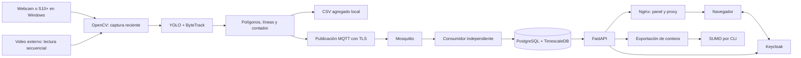

# CYSA — Gestión de tránsito y monitoreo semafórico

CYSA integra detección de vehículos, conteo por carril, MQTT, almacenamiento temporal, monitoreo web,
inventario y gestión de usuarios. Esta versión corresponde al **Sprint 1**, con las mejoras realizadas
hasta el **30 de octubre de 2026**.

El acceso y el panel comparten una interfaz con temas claro/oscuro y paleta blanca, gris, verde y negra.
El sistema permanece en **modo sombra**: consulta información y produce conteos; **no cambia semáforos
ni activa planes**. Las pruebas con webcam y Samsung S10+ apuntando a un video son de laboratorio.
La precisión formal en el corredor todavía requiere validación.

## Contenido

1. [Funciones y alcance](#1-funciones-y-alcance)
2. [Arquitectura y recorrido de datos](#2-arquitectura-y-recorrido-de-datos)
3. [Vistas y experiencia de uso](#3-vistas-y-experiencia-de-uso)
4. [Usuarios y permisos](#4-usuarios-y-permisos)
5. [Estructura y tecnologías](#5-estructura-y-tecnologías)
6. [Instalación y actualización](#6-instalación-y-actualización)
7. [Operación diaria](#7-operación-diaria)
8. [Webcam, celular y archivos de video](#8-webcam-celular-y-archivos-de-video)
9. [Carriles, conteo, motos y fluidez](#9-carriles-conteo-motos-y-fluidez)
10. [API, contratos y persistencia](#10-api-contratos-y-persistencia)
11. [SUMO y herramientas de operación](#11-sumo-y-herramientas-de-operación)
12. [Seguridad, privacidad y respaldos](#12-seguridad-privacidad-y-respaldos)
13. [Validación y diagnóstico](#13-validación-y-diagnóstico)
14. [Historial y documentación](#14-historial-y-documentación)

## 1. Funciones y alcance

| Área | Disponible en esta versión |
| --- | --- |
| Detección | YOLO preentrenado y ByteTrack; auto, micro y moto; cámara o archivo externo |
| Conteo | Polígonos, línea finita por carril y dirección de cruce; CSV agregado y MQTT |
| Visor | Video completo, formato vertical de menos de media pantalla de ancho y datos debajo |
| Edición | Marcar la vía, distribuir carriles y mover la línea; guardar/cancelar y volver al detector |
| Fluidez | Captura reciente e inferencia separadas del visor, sin cola acumulativa de video |
| Panel | Flujo vehicular, inventario, comunicación y usuarios; búsqueda, filtros y consultas periódicas |
| Identidad | Keycloak, login PKCE, dos roles, alta de usuarios, contraseña temporal y activación/desactivación |
| Apariencia | Acceso en español, temas persistentes y formularios/confirmaciones del mismo estilo |
| Datos | Conteos en TimescaleDB; inventario y último estado en PostgreSQL |
| Simulación | Escenario base SUMO y exportación de conteos por CLI, sin ejecutarse desde el panel |

La meta RF-03 de **error ≤10 % frente al conteo manual** no se considera cumplida por ver recuadros,
obtener buenos FPS o aprobar pytest. Requiere mediciones representativas por clase, carril e intervalo.
MFA, trazabilidad integral RF-02, optimización y autorización de planes siguen en los sprints siguientes.

## 2. Arquitectura y recorrido de datos



1. **Captura:** OpenCV abre la fuente por nombre/backend. El detector corre en el Python de Windows
   para acceder a la cámara; los servicios principales corren en Docker.
2. **Detección:** YOLO clasifica y ByteTrack asigna IDs temporales. Detectar no equivale a contar:
   el vehículo debe pertenecer a una zona y cruzar su segmento en la dirección válida.
3. **Agregación:** se producen conteos por intersección, acceso, carril y clase en intervalos de hasta
   30 segundos. El visor tiene acumulados de la ejecución, distintos de cada intervalo publicado.
4. **Entrega:** se escribe primero el CSV. Un trabajador publica con QoS 1 y espera PUBACK sin bloquear
   la ventana. «Registrado/encolado» no significa todavía guardado en la base.
5. **Consumo:** un proceso separado valida tópico y contrato, persiste y confirma el mensaje. Si la base
   falla reintenta; no registra el payload. Los mensajes inválidos se descartan.
6. **Consulta:** FastAPI consulta PostgreSQL. Nginx sirve los archivos web y dirige `/api/` al backend.
   El navegador no recibe claves de base, MQTT ni de la cuenta técnica de identidad.
7. **Acceso:** Keycloak entrega tokens mediante Authorization Code + PKCE. La API valida RS256,
   emisor, audiencia y fechas, y comprueba el estado y rol vigentes de la cuenta.

| Servicio | Responsabilidad | Acceso desde el host |
| --- | --- | --- |
| `panel` | Nginx, archivos web y proxy | `http://localhost:8088/` |
| `keycloak` | Realm `cysa`, usuarios, roles, sesiones y tema | `http://localhost:8080/` |
| `api` | Consultas, inventario y gestión de usuarios | Por `/api/`; sin puerto propio publicado |
| `consumer` | Suscripción MQTT y persistencia | Sin puerto publicado |
| `mosquitto` | Broker con TLS y ACL | `127.0.0.1:8883` |
| `db` | PostgreSQL 17 + TimescaleDB | Solo red Docker interna |

**Redes:** `operacional` es interna y conecta base, broker, consumidor y API; `panel` conecta API,
Nginx y Keycloak; `borde` permite publicar el puerto TLS del broker hacia Windows. La API es el único
servicio que enlaza las redes operacional y del panel. Esto no demuestra por sí solo una VLAN física.

## 3. Vistas y experiencia de uso

### Acceso y apariencia

El acceso de Keycloak y el panel comparten marca y selector **Apariencia → Claro/Oscuro**. La elección
se conserva mediante una cookie del mismo host y un valor visual en localStorage. **Los tokens no se
guardan en localStorage.** El tema no cambia permisos. La navegación es lateral en escritorio y se
adapta a pantallas pequeñas; las tablas tienen desplazamiento cuando no caben.

### Flujo vehicular

Muestra intersección, acceso/carril, clase, cantidad y periodo de cada registro. Permite filtrar por
intersección, buscar y consultar fechas. **Última hora** mantiene el periodo móvil; desactivarla habilita
el rango manual. Las consultas se renuevan cada 15 segundos con la pestaña visible.
Los indicadores resumen los registros disponibles en la vista, no un histórico ilimitado. Se cargan
200 intervalos inicialmente; **Cargar más registros** continúa la paginación. La API trabaja en UTC
y el navegador muestra hora local. **Contexto** diferencia validación y operación usando `prueba`
del contrato: cambiar su presentación no convierte datos de laboratorio en mediciones de campo.

### Inventario

Consulta activos, intersección/acceso, tipo, ubicación y protocolo. Incluye cámaras y controladores.
La vista actual es de consulta; el administrador carga o actualiza activos mediante la API protegida.
Los IDs deben coincidir con los utilizados por detección y simulación.

### Comunicación

Muestra fase, plan, estado reportado y antigüedad. Si pasan más de 30 segundos sin información se
destaca el dato como desactualizado. Es antigüedad del registro, no diagnóstico automático de avería
ni una orden al semáforo. En S1 pueden existir mensajes identificados de validación; la conexión con
el controlador emulado mantiene su planificación para los siguientes sprints.

### Usuarios

Solo aparece para administradores. La lista permite buscar, paginar y cambiar rol o estado.
**Crear usuario** abre un formulario independiente. Las altas administrativas y los cambios de acceso
requieren confirmación. **Guardar** se habilita cuando hay cambios. La cuenta propia está protegida
y las cuentas técnicas no se muestran. Cancelar borra los campos del formulario; durante el envío
se evita confundir su cierre con cancelar una petición que ya está en curso.

## 4. Usuarios y permisos

| Acción | Operador | Administrador |
| --- | --- | --- |
| Consultar conteos, inventario y comunicación | Sí | Sí |
| Crear cuentas y asignar uno de los dos roles | No | Sí |
| Cambiar rol o activar/desactivar otras cuentas | No | Sí |
| Cargar/actualizar inventario por API | No | Sí |
| Quitar su propio rol o desactivar su cuenta | No | No |
| Activar planes/controlar semáforos en esta versión | No | No |

Las altas usan **contraseña temporal de 12 a 128 caracteres**; Keycloak exige cambiarla al ingresar.
Los espacios de la clave se conservan exactamente; solo se recortan campos de perfil. La cuenta nace
desactivada, se le asigna el rol y después se habilita. Ante fallos se intenta dejarla desactivada o
limpiar el alta incompleta y no se informa éxito.

Cada lectura y escritura comprueba el permiso vigente. Desactivar o quitar un rol impide conservar
sus permisos con un token anterior. Los cambios cierran sesiones. Si falta configuración o identidad
no responde, la API **deniega la operación** en lugar de omitir el control.
Keycloak mantiene las cuentas y contraseñas; no se duplican en PostgreSQL. La API usa un cliente
confidencial `cysa-user-admin`, cuyo secreto se carga solo en `api` desde runtime local. Administrador
de CYSA no significa administrador maestro de Keycloak.

Una instalación nueva genera `administrador` y `operador`, con claves aleatorias. En la máquina de
laboratorio también se normalizaron cuentas conocidas a `admin.accesos` y `operador.transito`, sin
cambiar sus IDs, roles ni contraseñas. Esas dos cuentas adicionales **no aparecen por clonar GitHub**.

- `infra/runtime/clientes/usuarios-locales.json`: credenciales iniciales de esa máquina.
- `infra/runtime/clientes/cuentas-locales.json`: cuentas conocidas tras normalización local.
- `cysa.example` es un dominio reservado de laboratorio, sin envío de correo configurado.
- Para responsables reales crear cuentas personales con sus propios datos, sin inventar identidades.

**No subir credenciales ni compartirlas en commits, capturas o informes.**

## 5. Estructura y tecnologías

```text
backend/app/                 API, autenticación, usuarios, repositorio y consumidor
shared/cysa/                 Contratos Pydantic, interfaces y cliente MQTT/TLS
inventario/cysa_inventory/   Rutas y validación de activos; esquema en inventario/sql/
deteccion/cysa_detector/     Captura, inferencia, seguimiento, ROI, conteo y visor
deteccion/config/            Perfiles de cámara y plantillas de calibración
panel/                      Vistas, estilos, OIDC, usuarios, temas y confirmaciones
identidad/                  Realm, proxy y tema de Keycloak
infra/                      Compose, Dockerfile, SQL y broker
simulacion/                 SUMO, exportación y escenario base
tools/                      Preparación, operación, diagnóstico y validación
tests/                      Pruebas por módulo e integrante
data/                       Plantillas y ejemplos identificados
docs/                       Guías y evidencia técnica
```

| Componente | Versión de referencia |
| --- | --- |
| Python del contenedor | 3.12.10; entorno Windows con Python 3.12 |
| FastAPI / Uvicorn / Starlette | 0.136.0 / 0.34.2 / 1.10.0 |
| Pydantic / Psycopg | 2.11.4 / 3.2.9 |
| TimescaleDB / PostgreSQL | 2.19.3 / 17 |
| Mosquitto / Paho MQTT | 2.0.21 / 2.1.0 |
| Keycloak / Nginx | 26.8.1 / 1.30.6-alpine |
| PyJWT / cryptography | 2.15.1 / 50.0.2 |
| Ultralytics / OpenCV / LAP | 8.4.63 / 4.11.0.86 / 0.5.12 |
| Modelo del perfil S10+ | YOLO26s preentrenado; sin entrenamiento propio |
| SUMO | 1.27.0 |
| Pruebas | pytest 8.3.5 y pruebas OIDC con Node.js |

Las dependencias están en `requirements.txt`; las imágenes en Compose y `infra/.env.example`.
Un override de imagen en el `.env` local tiene prioridad sobre Compose.

## 6. Instalación y actualización

Requiere Git, Python 3.12 y Docker Desktop funcionando con contenedores Linux/WSL 2. La cámara
conectada del S10+ usa la función de dispositivos móviles de **Windows 11**. Node.js se utiliza para
las pruebas JavaScript, no para servir el panel. Para la validación formal revisar la referencia GPU/cámara IP.

### Instalación nueva

```powershell
git clone https://github.com/F4SG/CYSA.git
Set-Location CYSA
py -3.12 -m venv .venv
$py = (Resolve-Path .\.venv\Scripts\python.exe).Path
& $py -m pip install -r backend/requirements.txt -r deteccion/requirements.txt -r simulacion/requirements.txt -r tests/requirements.txt
& $py tools/franco/preparar_local.py --repo .
docker compose --env-file infra/.env -f infra/compose.yaml up -d --build
```

No es necesario activar el entorno usando `$py`. Los comandos se ejecutan desde la raíz del repo,
no desde `C:\Windows\System32`. En otra consola, volver a entrar a la carpeta y definir `$py`.
La preparación genera TLS/CA, `.env`, cuentas iniciales y entorno del cliente técnico. **Se ejecuta
una sola vez:** rechaza sobrescribir un runtime existente. Los secretos no vienen de GitHub.

Esperar a que Keycloak responda en `http://localhost:8080/realms/cysa`; el arranque puede tardar.
Después configurar el cliente técnico, aplicar tema y política local:

```powershell
& $py tools/franco/configurar_usuarios_local.py
& $py tools/franco/configurar_interfaz_local.py
& $py tools/franco/endurecer_identidad_local.py
docker compose --env-file infra/.env -f infra/compose.yaml up -d --build --no-deps api
Invoke-RestMethod http://localhost:8088/health
```

Abrir **[el panel](http://localhost:8088/)** con las credenciales generadas en esa máquina.
`status: ok` confirma respuesta de la API; `activacion_planes: false` es el comportamiento esperado.
Health no demuestra que cámara, broker y conteo estén validados de extremo a extremo.

Los pesos `.pt` no se versionan. El perfil del celular necesita `deteccion/modelos/yolo26s.pt`;
Ultralytics puede descargarlo al primer inicio con conexión. En un entorno sin red hay que
provisionarlo antes. Descarga y calentamiento inicial no son rendimiento continuo de detección.

### Actualizar una instalación existente

**Conservar volúmenes, runtime y `.env`.** No regenerar secretos para corregir un login. Antes de
actualizar Keycloak, respaldar su volumen con el servicio detenido: PostgreSQL no incluye identidad.
La actualización local del 30/10 se realizó con respaldo.

```powershell
Set-Location "$env:USERPROFILE\Documents\CYSA_S1\repo_s1"
git pull --ff-only origin master
$py = (Resolve-Path .\.venv\Scripts\python.exe).Path
& $py -m pip install -r backend/requirements.txt -r deteccion/requirements.txt -r simulacion/requirements.txt -r tests/requirements.txt
& $py tools/franco/configurar_usuarios_local.py --solo-archivos
docker compose --env-file infra/.env -f infra/compose.yaml up -d --build
```

`--solo-archivos` crea el entorno de gestión si falta, sin conectar a Keycloak ni rotar secretos.
Esto permite validar Compose aunque antes no existiera `usuarios-api.env`. Cuando Keycloak esté listo,
ejecutar los tres configuradores del bloque anterior y recrear API si cambió su entorno.
Revisar overrides `KEYCLOAK_IMAGE` y `NGINX_IMAGE`: un pin antiguo del `.env` no cambia con git pull.

La importación inicial del realm **no actualiza uno ya existente**. Por eso hay configuradores para
cliente técnico, tema y política. El endurecedor normaliza solo cuentas locales conocidas, comprueba
colisiones, respalda perfiles y restaura la edición de nombres. Revisarlo antes de usarlo con identidades reales.
`restart` no cambia imágenes: usar `up -d` para recrear. Los cambios de Nginx se validan con `nginx -t`
y se activan mediante recarga o recreación. Las rutas mostradas son las usadas en el laboratorio;
si clonaste en otra carpeta, reemplaza `Set-Location` por esa ubicación.

## 7. Operación diaria

### Servicios web y de datos

```powershell
Set-Location "$env:USERPROFILE\Documents\CYSA_S1\repo_s1"
docker compose --env-file infra/.env -f infra/compose.yaml up -d
docker compose --env-file infra/.env -f infra/compose.yaml ps
Invoke-RestMethod http://localhost:8088/health
```

Apagar conservando datos:

```powershell
docker compose --env-file infra/.env -f infra/compose.yaml stop
```

`stop` mantiene contenedores; `down` los elimina pero conserva volúmenes salvo indicación contraria.
**`down -v` borra los volúmenes:** no usarlo para solucionar fallos de acceso o actualización.

### Detector con vista previa

```powershell
$py = (Resolve-Path .\.venv\Scripts\python.exe).Path
& $py tools/cristhian/detector.py iniciar
```

El detector corre en Windows. Iniciar Compose no abre la cámara. **Q/Esc** cierra la ejecución.
El gestor permite que Editar carriles libere la cámara, abra el editor y regrese con la configuración
recargada. Iniciar directamente el módulo no ofrece ese ciclo automático de edición.

### Detector sin ventana

```powershell
& $py tools/cristhian/detector.py iniciar --segundo-plano
& $py tools/cristhian/detector.py estado
& $py tools/cristhian/detector.py detener
```

Crea una configuración con `show: false` sin sobrescribir la original y registra PID/fecha, log y
marcadores en `resultados/detector/`. La parada es cooperativa, sin matar otros Python. Para volver
al visor detenerlo e iniciar sin `--segundo-plano`. No abrir dos capturas del mismo dispositivo.

## 8. Webcam, celular y archivos de video

### Identificar el dispositivo

```powershell
& $py tools/cristhian/listar_camaras.py --backend msmf
& $py tools/cristhian/comprobar_camara.py --source 0
```

Los índices cambian al conectar equipos. Desconectar la webcam USB no desactiva la integrada.
El perfil S10+ prioriza **Galaxy S10+ (Windows Virtual Camera)** por nombre; si falta o es ambiguo,
falla y **no cambia silenciosamente a la laptop**. `comprobar_camara.py` descarta un cuadro: no abre
una vista continua ni demuestra que la escena o precisión sean correctas.

### Webcam USB

Conectar, listar su nombre y adaptar una copia de `deteccion/config/camara_usb.yaml`.
`REEMPLAZAR_POR_NOMBRE_DE_LA_WEBCAM` es una plantilla y debe reemplazarse. Revisar intersección y
encuadre: no reutilizar automáticamente las zonas del celular.

```powershell
& $py tools/cristhian/probar_camara_hd.py --source 0 --width 1280 --height 720 --fps 30
& $py tools/cristhian/detector.py iniciar --config deteccion/config/camara_usb.yaml --salida resultados/conteos_usb.csv
```

Cerrar la prueba de calidad con Q antes de iniciar el detector. En el laboratorio se apuntó la
webcam a una pantalla con video externo para ejercitar cámara → detector → conteos.

### Samsung Galaxy S10+

1. Vincularlo en **dispositivos móviles de Windows 11**.
2. Activar **Usar como cámara conectada** y conceder acceso en el teléfono. Bluetooth vinculado
   solamente no garantiza que ya esté disponible como cámara.
3. Confirmar el nombre con `listar_camaras.py` y utilizar la cámara trasera.
4. Fijar el teléfono apuntando al video, sin incluir el propio visor de CYSA dentro de lo filmado.
5. Calibrar la vía. En esta prueba se eligió **solo la inferior**, excluyendo puente, separador y acera.

```powershell
& $py tools/cristhian/probar_camara_hd.py --name "Galaxy S10+ (Windows Virtual Camera)" --width 1280 --height 720 --fps 30
```

Resolución y FPS son solicitudes; se muestra lo recibido realmente. La escala del visor no mejora
calidad óptica. Enfoque, reflejos, compresión, tamaño del vehículo y conexión afectan especialmente
las motos. Un cable USB conectado al teléfono no implica transporte de cámara por USB.
Para separar retraso del enlace y del detector, cerrar CYSA y comparar el S10+ en Cámara de Windows.
Si ambas reciben tarde, revisar el enlace; no atribuirlo al internet externo sin medir.
La edad mostrada por CYSA empieza cuando el cuadro llega a la PC, no en el sensor del celular.

### Video externo

El archivo se lee donde está y no se agrega al repositorio. Diagnóstico visual sin MQTT ni conteo:

```powershell
& $py tools/cristhian/probar_motos_video.py --video "C:\Video\Video-Reescalado.mp4" --desde 56
```

Para contar usar **otro YAML** basado en `calibracion_plantilla.yaml`: definir ruta en `source`,
intersección, CPU/GPU y zonas del archivo; quitar `camera_name` y desactivar `async_inference`.
`capture_latest` no se usa en archivos. No copiar las zonas del teléfono sin recalibrar.
El editor puede abrirlo con `calibrar_via.py --config <archivo.yaml>`.
Para comparar ventanas manuales ejecutar el módulo con `--inicio-video` y la hora real de inicio
con zona horaria: usa cuadro/FPS como reloj. Sin esa opción usa el tiempo de procesamiento de la PC,
que no equivale necesariamente al tiempo grabado. El módulo directo requiere entorno y credenciales MQTT.

## 9. Carriles, conteo, motos y fluidez

Las tres zonas actuales corresponden al encuadre guardado de la vía inferior: **no son universales
ni detección automática de marcas viales**. Si cambia el teléfono, la escena o la perspectiva, revisarlas.

| Control del visor | Acción |
| --- | --- |
| **L / Carriles** | Mostrar/ocultar polígonos, líneas y totales; el conteo continúa |
| **D / Datos** | Mostrar/ocultar tabla sin borrar acumulados |
| **E / Editar carriles** | Liberar captura y abrir el editor |
| **Q / Esc / Detener** | Finalizar detector |
| **R** | Recalibrar trayectorias solo en modo automático |

En el editor, **ESPACIO** fija/reanuda. Marcar las esquinas **lejana izquierda → lejana derecha →
cercana derecha → cercana izquierda**. **1–8** cambia cantidad, **U** deshace, **+/−** mueve la línea,
**S** guarda y **Q/Esc** cancela. También hay botones. La división por perspectiva propone anchos
uniformes: comprobar que coincidan con los carriles reales.

Guardar o cancelar vuelve al detector; cancelar mantiene el YAML anterior. Los acumulados de la
nueva ejecución parten de cero, pero CSV y base conservan el historial. Se libera la cámara antes
de abrir el editor. Para abrirlo directamente: `tools/cristhian/calibrar_via.py --iniciar`.
`delimitar_carriles.py` permite marcar cada zona y sus extremos de línea individualmente.
Las coordenadas son normalizadas 0–1, con origen arriba a la izquierda.

Se asigna el punto inferior central del recuadro a un polígono. Cuenta cuando su trayectoria cruza
el **segmento finito**, dentro de la zona y en la dirección definida. El ID contado se conserva entre
intervalos para no repetirlo en la misma ejecución. Oclusiones o pérdida de IDs aún requieren validación.

El modo `auto_carriles: true` agrupa trayectorias tras observación mínima y tres propuestas estables.
No garantiza detectar carriles vacíos o separar vías superpuestas; no publica ceros ficticios durante
calibración. Para usarlo desactivar `crop_to_lanes`, que requiere zonas fijas. El perfil actual usa zonas manuales.

### Motos y rendimiento

YOLO26s sigue preentrenado: no se entrenó otro modelo. El perfil S10+ solicita 1280×720 a 30 FPS en CPU:

| Parámetro | Valor y propósito |
| --- | --- |
| `imgsz` | 512 para inferencia, diferente de captura/visor |
| `confidence` / `class_confidence: 3` | 0,25 general / 0,15 para motorcycle |
| `track_confidence` | 0,10 antes del filtro por clase |
| `crop_to_lanes` / `roi_padding` | ROI interno de carriles fijos con margen 0,15 |
| `capture_latest` | Un cuadro reciente pendiente de captura |
| `async_inference` | Detección separada del video y controles |

El ROI aumenta el tamaño útil de vehículos pequeños. Restaura coordenadas al cuadro completo
**antes** de asignar, contar y dibujar. El visor conserva toda la imagen.
La inferencia mantiene un trabajo activo y un pendiente reemplazable; no acumula video atrasado.
Cada resultado se cuenta una vez. Los recuadros de más de 180 ms se ocultan sin eliminar el conteo.
**IA** es tiempo de inferencia; FPS de visor no equivale a FPS de detección ni latencia total del celular.

En una comparación de 60 cuadros en RAM el visor síncrono rondó 14 FPS y el separado 30 FPS.
Muestras seleccionadas mejoraron en aparición/continuidad de motos con ROI. No demuestra precisión
exhaustiva ni latencia real del teléfono. Ver [evidencia del ROI](docs/cristhian/mejora_motos_roi.md)
y [visor/edición](docs/cristhian/visor_completo.md). El modelo mediano es experimental y más pesado.

## 10. API, contratos y persistencia

| Ruta | Función | Permiso |
| --- | --- | --- |
| `GET /health` | Respuesta de API y activación deshabilitada | Público |
| `GET /api/conteos` | Rango, intersección, carril, contexto y paginación | Operador o administrador |
| `GET /api/estados` | Último estado por intersección | Operador o administrador |
| `GET /api/inventario` | Activos | Operador o administrador |
| `POST /api/inventario/carga` | Alta/actualización por lote validado | Administrador |
| `PUT /api/inventario/{activo_id}` | Actualizar activo existente | Administrador |
| `GET /api/usuarios` | Buscar y paginar cuentas de CYSA | Administrador |
| `POST /api/usuarios` | Perfil, rol y contraseña temporal | Administrador |
| `PATCH /api/usuarios/{uuid}` | Cambiar rol y estado | Administrador; sin modificar su propia cuenta |

`/api/planes` no está implementado como activación. Las interfaces y contratos reservados no habilitan
control. Sin token se devuelve 401; sin permiso, 403; datos inválidos, 422; conflictos de cuentas, 409;
identidad indisponible, 503. La carga de inventario exige de 1 a 2000 activos y rechaza IDs duplicados.
La lista de usuarios admite hasta 50 por página; la API de conteos limita rangos a 31 días.

### Contratos y mensajes

Pydantic rechaza campos extra, cantidades negativas, IDs inválidos y fechas sin zona horaria.
Un conteo incluye UUID, intersección, acceso, carril, clase, cantidad, inicio, fin y `prueba` booleano.
El intervalo debe ser mayor que cero y de hasta 30,5 segundos. No admite imágenes, video ni placas.
Los estados incluyen UUID, intersección, fase, plan, estado de comunicación, timestamp y contexto.

- Conteos MQTT: `corredor/{interseccion}/{acceso}/conteos`.
- Estados MQTT: `corredor/{interseccion}/estado`.
- El usuario técnico detección publica conteos; plataforma lee; emulador publica estados.
- El broker aplica TLS, credenciales y ACL. No se publica el puerto MQTT plano 1883.

`conteos` es una hypertable con clave `(mensaje_id, inicio)`: reenviar ese mismo evento no crea otra
fila. Un UUID nuevo sí representa otro evento. `estados` conserva el último mensaje por intersección
y evita que uno anterior lo reemplace. `inventario` guarda activos. No hay cuadros ni claves de Keycloak en la base.

La cola de publicación tiene un máximo de 64 eventos. Ante error o saturación, el CSV previo permite
recuperar sin inventar UUID nuevos:

```powershell
. .\tools\franco\entorno.ps1
& $py tools/franco/cargar_env.py infra/runtime/clientes/deteccion.env -- python tools/cristhian/reenviar_conteos.py resultados/conteos_s10.csv
```

`entorno.ps1` configura PYTHONPATH sin cargar claves. `cargar_env.py` entrega credenciales al proceso
hijo sin imprimirlas. `login_local.py` permite comandos/exportaciones con login OIDC real y token
en memoria, sin pegarlo en consola. No mezclar corridas superpuestas como si fueran una sola medición.

## 11. SUMO y herramientas de operación

SUMO recibe conteos agregados y un mapeo entre accesos y aristas. Genera demanda, ejecuta el plan fijo
de referencia y resume `timeLoss`. No se lanza desde el navegador ni controla semáforos físicos.
El escenario DEMO es sintético; no representa por sí solo todo el corredor.

```powershell
& $py simulacion/sumo_base.py --counts data/leonardo/ejemplos/flujos_DEMO.csv --out resultados/sumo_demo_nueva_corrida --demo
```

La salida debe ser nueva/vacía. Una red real requiere `--network` y `--access-map`.
`simulacion/exportar_conteos.py` obtiene CSV autenticado de la API usando `CYSA_TOKEN` del proceso hijo.
Webster, prioridades, validación previa y aprobación con MFA no se completan por ejecutar la simulación base.

| Herramienta | Uso |
| --- | --- |
| `preparar_local.py` | Generar una vez secretos, TLS, realm y configuración |
| `configurar_usuarios_local.py` | Provisionar cliente técnico; `--solo-archivos` prepara su entorno sin conectarse |
| `configurar_interfaz_local.py` | Aplicar tema e idioma sin reemplazar cuentas |
| `endurecer_identidad_local.py` | Política y normalización de cuentas locales conocidas |
| `diagnostico.py` | Entorno, servicios y archivos |
| `verificar_tls.py` | Rechazo de MQTT plano y publicación TLS |
| `aceptacion_local.py` | Ensayo sintético de integración con servicios reales y login |
| `inspeccionar_bd.py` | Esquema, hypertable y duplicados desde el contenedor |
| `respaldo.py` / `restaurar_copia.py` | Respaldo de PostgreSQL y verificación en una base nueva |
| `comprobar_privacidad.py` | Multimedia en las rutas revisadas |

Las herramientas generales están en `tools/franco/`; las de cámara/calibración/privacidad en
`tools/cristhian/`. Las interfaces de dispositivos están en `shared/cysa/interfaces.py` y reservan
la activación para las siguientes etapas, exigiendo validación, autorización y MFA.

## 12. Seguridad, privacidad y respaldos

La revisión corrigió la omisión de permisos por configuración incompleta, acceso con roles revocados,
carreras de renovación OIDC y alteración de contraseñas por recorte de espacios. Añadió bloqueo
temporal ante intentos fallidos, política de claves, cliente de identidad sin redirecciones y
respuestas acotadas, y cabeceras de seguridad del panel. Se retiraron imports, exports y estilos
sin uso identificados; se conservaron puntos de entrada CLI y callbacks utilizados dinámicamente.

Keycloak, Nginx, PyJWT y pip del contenedor API se actualizaron tras revisar avisos de los proveedores.
La consulta final a OSV no devolvió avisos para las **21 dependencias Python instaladas en la API**
a esa fecha. No cubre paquetes de sistema, todas las imágenes ni Windows. El consumidor existente
no se reinició durante esa revisión; el Dockerfile compartido incorpora las correcciones para su
siguiente reconstrucción. Ver [auditoría y límites](docs/franco/auditoria_seguridad_2026_10_30.md).

- Los cuadros se procesan en RAM y se descartan; CSV/MQTT guardan conteos agregados.
- No se versionan `.env`, runtime, claves privadas, pesos, videos, resultados ni respaldos.
- Los tokens viven en memoria; cookie y localStorage de tema solo almacenan apariencia.
- Los logs de cuentas registran actor/operación sin claves; no sustituyen la auditoría persistente RF-02.
- Antes de usar varias instancias/trabajadores de API se necesita coordinación distribuida de mutaciones.

### Respaldar y verificar

```powershell
& $py tools/franco/respaldo.py --out respaldos/monitoreo_2026_10_30.dump
& $py tools/franco/restaurar_copia.py --file respaldos/monitoreo_2026_10_30.dump --database cysa_restore_revision
```

La restauración solo admite una base **nueva** `cysa_restore_*`, sin reemplazar `cysa`. Elegir nombres
de salida nuevos y comparar datos antes de validar el respaldo. El dump cubre monitoreo e inventario,
**no Keycloak ni TLS**. Identidad necesita su propia copia consistente con Keycloak detenido.
Los respaldos pueden contener información sensible y permanecen fuera de Git.

### Despliegue

La configuración publica únicamente en localhost y usa `start-dev`/HTTP para panel e identidad.
**No es una configuración de producción expuesta a internet.** Antes de desplegar se requieren HTTPS,
configuración productiva, gestión de secretos, revisión de imágenes/host, MFA y auditoría integral.
Una revisión acotada sin hallazgos no certifica «cero vulnerabilidades».

## 13. Validación y diagnóstico

```powershell
& $py tools/franco/probar.py
node --test tests/franco/oidc.test.mjs
```

La revisión de esta publicación incluye **167 pruebas Python y 3 JavaScript**. La suite conserva
una advertencia preexistente de deprecación del TestClient; no es un fallo de ejecución.
Las pruebas cubren contratos, geometría, conteo, coordenadas del ROI, captura/inferencia recientes,
visor, editor, permisos, JWT, altas y errores. JavaScript comprueba renovación única concurrente,
fallo de renovación y cierre de sesión durante ella. La preparación previa a Compose comprueba
que se pueda generar el entorno sin conectar con Keycloak ni rotar secretos.

También se ejercitó panel + API + Keycloak real con un navegador aislado sin ventana: ambos roles,
contraseña temporal, temas, móvil, cambios de acceso, tokens manipulados y revocación. Las cuentas
desechables se eliminaron; los resultados locales no se confunden con validación de campo.

### Precisión de conteo

El conteo manual debe coincidir en intersección, acceso, carril, clase e intervalo con zona horaria
y cobertura completa. Hay plantillas en `data/cristhian/plantillas/`.

```powershell
& $py tools/cristhian/preparar_calibracion.py resultados/conteo_manual.csv resultados/conteos_s10.csv resultados/calibracion.csv
& $py tools/cristhian/calibrar.py resultados/calibracion.csv resultados/calibracion_evaluada.csv
```

Con manual cero no hay base porcentual: se revisan falsos positivos. Medir auto, micro y moto por
separado. **Micro** se apoya en la clase COCO bus; no garantiza clasificar todos los micros locales.

### Problemas frecuentes

| Síntoma | Comprobación / solución |
| --- | --- |
| No encuentra `.env` o `.venv` | Entrar a la raíz; no usar rutas relativas desde System32 |
| Falta `usuarios-api.env` | `configurar_usuarios_local.py --solo-archivos` antes de Compose |
| Gestión devuelve 503 | Confirmar Keycloak, cliente técnico y entorno; configurar y recrear API |
| 401 | Volver a ingresar; revisar emisor, audiencia, reloj y JWKS; no regenerar secretos |
| 403 tras cambiar rol/desactivar | Es esperado: se verifica el permiso vigente |
| Nombre de cuenta anterior no ingresa | Consultar `cuentas-locales.json`; cambiaron nombres, no claves |
| Diseño anterior | Ctrl+F5; puede pedir login porque los tokens están solo en memoria |
| Cámara equivocada | Revisar nombre/backend; el índice no es estable |
| Negro o cierre al editar | Cerrar otras capturas, revisar permisos/enlace; el editor espera imagen útil |
| Motos sin recuadro | Revisar tamaño, enfoque y ROI; comparar falsos positivos antes de cambiar umbrales/modelo |
| Retraso | Comparar Cámara de Windows y CYSA; revisar enlace, FPS de visor/IA y capturas duplicadas |
| Panel sin registros nuevos | Revisar detector, CSV, MQTT, consumidor, rango y contexto; health no prueba todo el flujo |
| YAML celular usado como archivo/automático | Quitar `camera_name`, desactivar asincronía para archivo y ROI para automático |

### Pendientes del alcance

| Área | Estado |
| --- | --- |
| Monitoreo, contratos, persistencia, inventario y roles | Implementados con pruebas locales de software/integración |
| Webcam/S10+ | Flujo de laboratorio disponible; precisión y latencia de campo pendientes |
| RF-03 ≤10 % | Falta medición representativa y revisión por clase/carril |
| RF-12 | Gestión S1 implementada; MFA y pruebas continúan en S2/S3 |
| RF-02, autorización, prioridades, emulador e integración final | Mantienen su planificación en los sprints siguientes |
| Aprobación formal y despliegue | Requieren aceptación y validación; no se infieren de pytest |

## 14. Historial y documentación

| Etapa | Cambios |
| --- | --- |
| Base S1, 26/10 | Compose, TLS/ACL, contratos, MQTT, TimescaleDB, roles, panel inicial, inventario, SUMO y respaldo |
| Cámara, 27/10 | Webcam/S10+, selección por nombre, resolución recibida, ventana persistente y gestor portable |
| Integración, 28/10 | Líneas independientes sin polígonos, aislamiento de redes y plantilla de calibración |
| Conteo/motos, 30/10 | Solo vía inferior, polígonos/líneas, editor con captura abierta, YOLO26s, umbral por clase y ROI |
| Fluidez, 30/10 | Captura reciente, IA separada, publicación fuera del hilo de video y visor vertical editable |
| Usuarios, 30/10 | API conectada a Keycloak, ambos roles, clave temporal, estado y autoprotección |
| Interfaz, 30/10 | Acceso/panel unificados, español, temas persistentes, navegación adaptable y diálogos |
| Revisión, 30/10 | Perfiles funcionales, permisos vigentes, protección de intentos, correcciones OIDC/claves, componentes actualizados y limpieza |

### Guías detalladas

- [Referencia del proyecto y pruebas en vivo](docs/cristhian/referencia_proyecto_y_prueba_vivo.md).
- [Calibrar solo vía inferior](docs/cristhian/calibrar_solo_via_inferior.md).
- [Mejora de motos y ROI](docs/cristhian/mejora_motos_roi.md).
- [Visor, controles y edición](docs/cristhian/visor_completo.md).
- [Gestión de usuarios](docs/franco/gestion_usuarios_local.md).
- [Interfaz y temas](docs/franco/interfaz_cysa.md).
- [Auditoría de seguridad](docs/franco/auditoria_seguridad_2026_10_30.md).
- [Guía de operación en PC](docs/franco/guia_completa_pc_franco.md).

Proyecto académico de gestión semafórica. Equipo: **Franco (F4SG), Cristhian y Leonardo**.
Franco: infraestructura, contratos, backend, identidad y operación; Cristhian: detección, conteo,
inventario y privacidad; Leonardo: panel, SUMO y reglas de simulación. La planificación y los criterios
de aceptación son la referencia para declarar cumplimiento, no la apariencia del panel.
