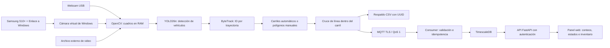

# CYSA — Sistema de Monitoreo Semaforico (Sprint 1)

> Gestión Semafórica — Sprint 1 y pruebas de detección de laboratorio del 27/10/2026.
> La detección con webcam y Samsung S10+ es una prueba; la validación de precisión en campo sigue pendiente.
> Sistema de conteo vehicular, monitoreo de estados, inventario de activos e infraestructura segura.

## A. Descripcion general

### Objetivo
- Recibir y persistir conteos vehiculares y estados de semaforo.
- Gestionar inventario de activos por rol.
- Visualizar datos en tiempo real en el Panel de Monitoreo web.
- Simular demandas base con SUMO para calibracion futura.

### Tecnologias y herramientas

| Capa | Tecnologia | Version |
|---|---|---|
| Lenguaje backend | Python | 3.12.10 |
| API REST | FastAPI + Uvicorn | 0.136.0 / 0.34.2 |
| Contratos de datos | Pydantic v2 | 2.11.4 |
| Base de datos | TimescaleDB (PostgreSQL 17) | 2.19.3-pg17 |
| Broker MQTT | Eclipse Mosquitto (TLS) | 2.0.21 |
| Cliente MQTT | Paho-MQTT | 2.1.0 |
| Autenticacion | Keycloak (OIDC + PKCE) | 26.7.0 |
| Panel web | HTML + JS + CSS vanilla | - |
| Proxy web | Nginx | 1.28.0-alpine |
| Orquestacion | Docker Compose v2 | v5.6.1 |
| Simulacion vehicular | Eclipse SUMO | 1.27.0 |
| Deteccion (S1, RF-03) | Ultralytics YOLO26n, OpenCV | 8.4.63 / 4.11.0.86 |
| Autenticacion JWT | PyJWT + cryptography | 2.10.1 / 50.0.2 |
| Tests | pytest | 8.3.5 |

### Requisitos minimos

| Requisito | Minimo |
|---|---|
| OS | Windows 10/11 64-bit con WSL 2 |
| RAM | 8 GB (recomendado 16 GB) |
| Disco | 20 GB libres |
| Python | 3.12.x 64-bit |
| Docker Desktop | 4.x con backend WSL 2 |
| Git | 2.40 o superior |

---

## B. Arquitectura del proyecto

### Redes Docker
- `operacional` (internal: true): DB <-> Mosquitto <-> Consumer <-> API
- `panel`: API <-> Keycloak <-> Nginx (accesible desde localhost)
- `borde`: solo Mosquitto, para publicar `127.0.0.1:8883` al detector (una red interna no puede publicar puertos)
- La API es el unico servicio en `operacional` y `panel`; la base y el consumidor no estan en la red del panel.

### Puertos expuestos en localhost

| Puerto | Servicio |
|---|---|
| 8088 | Panel web (Nginx) |
| 8080 | Keycloak |
| 8883 | Broker MQTT TLS |

### Estructura de carpetas

```
repo_s1/
├── backend/           # API REST FastAPI (Franco)
├── shared/            # Contratos compartidos Pydantic (Franco)
├── inventario/        # Modulo de inventario (Cristhian)
├── deteccion/         # Detector vehicular YOLO (Cristhian) - S1, RF-03
├── simulacion/        # SUMO + exportacion (Leonardo)
├── panel/             # Interfaz web HTML/JS/CSS (Leonardo)
├── identidad/         # Configuracion Keycloak + Nginx (Franco)
├── infra/             # Docker Compose + Dockerfiles (Franco)
├── data/              # Plantillas y datos por integrante
├── tools/             # Herramientas de prueba y operacion
├── tests/             # Suite de pruebas del sistema y detector
├── docs/              # Documentacion por integrante
├── .gitignore
├── .dockerignore
└── README.md
```

---

## C. Distribucion del trabajo

| Integrante | Responsabilidad | Modulos |
|---|---|---|
| Franco (F4SG) | Infraestructura, contratos, backend API, MQTT/TLS, Keycloak | backend/, shared/, infra/, identidad/, tools/franco/, tests/franco/, docs/franco/ |
| Cristhian | Inventario, deteccion YOLO (RF-03, S1), privacidad | inventario/, deteccion/, tools/cristhian/, tests/cristhian/, docs/cristhian/ |
| Leonardo | Panel web, SUMO, reglas semaforicas | panel/, simulacion/, tests/leonardo/, docs/leonardo/ |

---

## D. Instalacion desde cero

### 1. Requisitos previos

Instalar Git (https://git-scm.com/download/win), Python 3.12 64-bit
(https://www.python.org/downloads/) y Docker Desktop (https://www.docker.com/products/docker-desktop/).

Para WSL 2 (si no esta instalado):
```powershell
wsl --install
wsl --set-default-version 2
```

### 2. Clonar el repositorio

```powershell
git clone https://github.com/F4SG/CYSA.git
Set-Location CYSA
```

### 3. Crear entorno virtual e instalar dependencias

```powershell
py -3.12 -m venv .venv
.venv\Scripts\Activate.ps1
pip install -r backend/requirements.txt
pip install -r deteccion/requirements.txt
pip install -r simulacion/requirements.txt
pip install -r tests/requirements.txt
```

### 4. Generar configuracion local (TLS + credenciales)

Ejecutar una sola vez. Requiere Docker Desktop activo.

```powershell
$env:PYTHONPATH = @("$PWD/shared","$PWD/backend","$PWD/inventario","$PWD/deteccion") -join ';'
python tools/franco/preparar_local.py --repo .
```

Genera en infra/runtime/ (excluida del repositorio):
- infra/.env con credenciales de BD, MQTT y Keycloak
- infra/runtime/mqtt/ con CA y certificados TLS del broker
- infra/runtime/keycloak/cysa-realm.json importado al inicio
- infra/runtime/clientes/ con credenciales locales de prueba

### 5. Verificar la instalacion

```powershell
$env:PYTHONPATH = @("$PWD/shared","$PWD/backend","$PWD/inventario","$PWD/deteccion") -join ';'
python tools/franco/diagnostico.py --out resultados/diagnostico.json
python tools/franco/probar.py
```

---

## E. Encendido, apagado y operacion

IMPORTANTE: Ejecutar todos los comandos docker compose desde la carpeta raiz del proyecto.
Si aparece `couldn't find env file`, primero ejecutar Set-Location hacia la carpeta del proyecto.

### ENCENDER los servicios

```powershell
Set-Location "$env:USERPROFILE\Documents\CYSA_S1\repo_s1"

# Uso habitual (contenedores ya existen)
docker compose --env-file infra/.env -f infra/compose.yaml start

# Primera vez o despues de un 'down'
docker compose --env-file infra/.env -f infra/compose.yaml up -d --build
```

### APAGAR los servicios (datos conservados)

```powershell
Set-Location "$env:USERPROFILE\Documents\CYSA_S1\repo_s1"
docker compose --env-file infra/.env -f infra/compose.yaml stop
```

NUNCA usar `down -v` - borra los volumenes y pierde la base de datos.

### Verificar estado

```powershell
docker compose --env-file infra/.env -f infra/compose.yaml ps
Invoke-RestMethod http://localhost:8088/health
```

### Panel web

Abrir: http://localhost:8088
Credenciales locales en: infra/runtime/clientes/usuarios-locales.json

### Reiniciar un servicio especifico

```powershell
docker compose --env-file infra/.env -f infra/compose.yaml restart keycloak
docker compose --env-file infra/.env -f infra/compose.yaml restart api
```

### Errores comunes

| Error | Causa | Solucion |
|---|---|---|
| couldn't find env file | PowerShell fuera de la carpeta del proyecto | Set-Location a la raiz del proyecto |
| ERR_CONNECTION_REFUSED en panel | Keycloak no corre | restart keycloak + ver logs |
| API 401 sesion invalida | Scope basic sin claim sub | Regenerar con preparar_local.py |
| ConnectionRefusedError en verificar_tls | Mosquitto sin puerto expuesto | Verificar ports 8883 en compose.yaml |
| docker compose start falla | Contenedores no existen | Usar up -d --build la primera vez |
| ModuleNotFoundError en pytest | PYTHONPATH no configurado | Configurar PYTHONPATH con shared, backend, inventario, deteccion |
| Keycloak Exited 1 inmediato | JSON invalido en cysa-realm.json | python -c "import json; json.load(open(...))" - regenerar si falla |

---

## F. Cómo funciona la detección y cómo reproducir las pruebas

### F.1. Flujo completo



La cámara y YOLO se ejecutan con Python en Windows, fuera de Docker. Docker aloja los servicios del backend. El detector requiere las credenciales MQTT generadas en `infra/runtime/clientes/deteccion.env`; no basta con encender la cámara. El panel consulta los datos agregados, no transmite video.

Se usan las clases COCO `car → auto`, `motorcycle → moto` y `bus → micro`. El último mapeo es una aproximación: no reconoce por sí solo todos los tipos locales de transporte. Los camiones no están incluidos por defecto.

Cada vehículo se sigue mediante un ID. El punto de referencia es el centro inferior de su recuadro. **Ver un vehículo no incrementa el aforo**: su trayectoria debe cruzar el segmento finito de conteo dentro del polígono de un carril y en el sentido indicado. El flujo de ejecución asigna un carril y evita contar el mismo ID en un segundo carril. Los IDs de cruce se conservan entre intervalos, pero caducan tras 120 s sin observación; reinicios, oclusiones o cambios de ID pueden generar errores.

Cada intervalo produce un evento por carril y clase, incluidos ceros cuando hubo observación. Se respalda el evento en CSV y después se publica con TLS/QoS 1. Un CSV puede contener eventos pendientes de publicar si se cae MQTT. El tiempo máximo de un intervalo es 30,5 s; si se excede, el detector se detiene. El CSV contiene datos agregados, no cuadros, placas ni recortes.

### F.2. Preparación común y selección de la cámara correcta

Ejecutar desde la raíz del repositorio, con Docker Desktop abierto:

```powershell
$py = "$PWD\.venv\Scripts\python.exe"
$env:PYTHONPATH = "$PWD\shared;$PWD\deteccion"
& $py -m pip install -r deteccion/requirements.txt

docker compose --env-file infra/.env -f infra/compose.yaml up -d
Invoke-RestMethod http://localhost:8088/health

& $py tools/cristhian/listar_camaras.py --backend msmf
```

Si es la primera instalación, completar antes la sección D para generar certificados, credenciales y realm. En las pruebas se usó una PC con cámara integrada, una webcam USB y posteriormente un Galaxy S10+. **Desconectar la webcam no elimina la cámara integrada**: el índice `0` llegó a seleccionar la laptop. Los índices cambian; resolución, orden de conexión e índice no demuestran la identidad.

`camera_name` selecciona por nombre exacto o por un fragmento único de la lista. Tiene prioridad sobre `source` numérico. Si no encuentra una única coincidencia, falla y muestra las cámaras disponibles, sin usar una sustituta. `msmf` corresponde a Media Foundation y admite la cámara virtual de Windows; el índice enumerado se abre con ese mismo backend. La enumeración requiere `cv2-enumerate-cameras` en Windows.

Ejemplo actual de laboratorio en `deteccion/config/carriles_cristhian.yaml`:

```yaml
source: 1                         # camera_name tiene prioridad sobre este índice
camera_name: Galaxy S10+ (Windows Virtual Camera)
camera_backend: msmf
camera_width: 1920
camera_height: 1080
camera_fps: 30
show: true
prueba: true
interseccion: DEMO_INT_01
auto_carriles: true
calibracion_s: 12
intervalo_s: 10
```

La resolución y los FPS son **solicitudes al controlador**, no garantías. La ventana y la consola muestran el ancho y alto de los cuadros recibidos. El FPS informado por el controlador tampoco equivale a la velocidad de inferencia. No se amplían artificialmente los cuadros para fingir Full HD. El modelo realiza su propio preprocesamiento; aumentar la captura no implica inferencia a 1920×1080 ni mayor precisión demostrada.

### F.3. Prueba con webcam USB

1. Conectar la webcam, listar dispositivos y localizar su nombre exacto.
2. Copiar `deteccion/config/camara_usb.yaml` a un archivo propio y reemplazar `camera_name: REEMPLAZAR_POR_NOMBRE_DE_LA_WEBCAM` por ese nombre. No elegir por índice sin comprobar la imagen.
3. Cerrar otras aplicaciones que usen esa cámara y probar video en directo:

```powershell
& $py tools/cristhian/probar_camara_hd.py --name "NOMBRE_EXACTO_DE_LA_WEBCAM" --width 1280 --height 720 --backend msmf
```

4. Confirmar la imagen y el tamaño real recibido. Pulsar **Q** para liberar la cámara.
5. Iniciar el detector con el archivo de esa webcam:

```powershell
& $py tools/cristhian/detector.py iniciar --config deteccion/config/camara_usb.yaml --salida resultados/conteos_usb.csv
```

En la prueba de laboratorio se apuntó la cámara hacia una pantalla con un video de tráfico descargado, conservado fuera del repositorio. Eso comprueba el flujo óptico de cámara → modelo → conteos; no representa una medición en calle. El ángulo, los reflejos, el enfoque y el patrón de píxeles de la pantalla afectan el resultado.

### F.4. Prueba con Samsung Galaxy S10+ como cámara

Requisitos de la función nativa de Microsoft: Windows 11 o posterior, Android 10 o posterior y Enlace a Windows 1.24022.0 o posterior. Mantener el PC y el teléfono conectados a la misma red Wi-Fi durante la prueba.

1. Instalar o actualizar **Enlace a Windows** en el S10+.
2. En el PC: **Configuración → Bluetooth y dispositivos → Dispositivos móviles → Agregar dispositivo → Android**. Completar la vinculación y los códigos en el teléfono.
3. Entrar en **Galaxy S10+** y activar **Usar como cámara conectada**. Aceptar en el celular los permisos que correspondan. Emparejar solo por Bluetooth no basta.
4. En **Bluetooth y dispositivos → Cámaras** comprobar que aparece **Galaxy S10+ (Windows Virtual Camera)**. Su vista previa debe mostrar la cámara del teléfono.
5. Elegir la cámara trasera, mantener el teléfono fijo y cerrar la vista previa de Windows antes de abrir CYSA.
6. Probar la captura por nombre:

```powershell
& $py tools/cristhian/probar_camara_hd.py --name "Galaxy S10+ (Windows Virtual Camera)" --width 1920 --height 1080 --fps 30 --backend msmf
```

Esperar unos segundos al iniciar. La prueba mantiene el flujo abierto, a diferencia de una comprobación de un solo cuadro que puede capturar negro durante el arranque. **Q** o **Esc** cierra la prueba y libera la cámara.

Durante la sesión se observó la vista en vivo del S10+ en Windows. Las comprobaciones iniciales por índice entregaron 640×480 y 1280×720, pero esos tamaños no identifican qué dispositivo respondió. También hubo un arranque que informó 1920×1080 y luego se identificó visualmente como la cámara de la laptop: ese registro no acredita Full HD del S10+. La selección por nombre se añadió después para corregir esta ambigüedad; hay que verificar la resolución real del S10+ al volver a ejecutar.

Si se ve borroso, comparar con la aplicación Cámara del teléfono: limpiar la lente, comprobar enfoque, distancia e iluminación y confirmar que se usa la trasera. Si solo se degrada en el PC, revisar resolución recibida y enlace inalámbrico. No prometer 4K, todos los megapíxeles ni la misma calidad de la app nativa por usar una cámara virtual.

El iPhone 15 Pro también se vinculó durante la sesión, pero no se utilizó como fuente validada del detector. La opción nativa de cámara conectada documentada por Microsoft corresponde a Android.

Fuentes de configuración: [cámara móvil en Windows](https://support.microsoft.com/en-us/windows/apps/phonelink/use-your-mobile-device-s-camera), [enfoque y calidad de cámara Samsung](https://www.samsung.com/us/support/troubleshoot/TSG10004888/), [enumeración de cámaras y backends](https://github.com/lukehugh/cv2_enumerate_cameras).

### F.5. Iniciar, detener y reiniciar con el sistema corriendo

Los siguientes comandos están dentro del repositorio. No requieren scripts guardados en una carpeta de Codex ni rutas de usuario particulares. El gestor carga las credenciales locales sin imprimirlas y fija su directorio de trabajo en la raíz del repositorio.

**Con vista previa, carriles y contadores** (`show: true` en YAML):

```powershell
& $py tools/cristhian/detector.py iniciar
```

También sigue funcionando la ejecución directa:

```powershell
& $py tools/franco/cargar_env.py infra/runtime/clientes/deteccion.env -- python -m cysa_detector.run --config deteccion/config/carriles_cristhian.yaml --salida-conteos resultados/conteos_s10.csv
```

**En segundo plano, sin ventana de video**:

```powershell
& $py tools/cristhian/detector.py iniciar --segundo-plano
& $py tools/cristhian/detector.py estado
```

El gestor crea una configuración de ejecución con `show: false` sin modificar el archivo original. Guarda PID/fecha de creación, log y marcadores de control en `resultados/detector/`, excluido de Git. Impide iniciar otro proceso gestionado si el anterior sigue activo. Una confirmación de cámara abierta no acredita todavía la calibración ni recepción de conteos en el panel: revisar los mensajes siguientes del registro.

**Detener el proceso gestionado en segundo plano y reiniciar**:

```powershell
& $py tools/cristhian/detector.py detener
& $py tools/cristhian/detector.py iniciar --segundo-plano
```

La parada es cooperativa: termina la operación actual y conserva los CSV. Si una lectura, inferencia o publicación está bloqueada, la orden puede quedar pendiente; no fuerza el cierre. Para procesos iniciados en primer plano usar **Q**, **Esc** o **Ctrl+C**. El gestor no administra procesos antiguos iniciados con scripts de fuera del repositorio: detenerlos antes de migrar, para no capturar la cámara dos veces.

En modo sin ventana **no aparece vista previa**. Para volver a verla, detener el proceso gestionado e iniciar sin `--segundo-plano`, con `show: true`.

### F.6. Carriles automáticos, asignación y límites

Con `auto_carriles: true`, el detector observa trayectorias antes de contar:

1. Filtra recorridos con suficientes observaciones y desplazamiento, descartando vehículos quietos.
2. Estima el eje dominante del tráfico y agrupa recorridos cercanos, separando sentidos opuestos.
3. Propone polígonos por carril, segmentos de conteo y dirección de cruce.
4. Espera al menos `calibracion_s` y tres estimaciones consecutivas estables antes de activarlos.
5. Asigna a cada vehículo el carril cuyo polígono contiene su punto inferior central; muestra ID, clase y carril con el mismo color que la zona.
6. Cuenta únicamente el cruce válido. Los vehículos sin carril asignado no suman. Durante calibración se muestran en gris, sin publicar ceros ficticios.

La ventana muestra polígonos, líneas, flechas y totales acumulados de esa ejecución. El CSV y MQTT se emiten por intervalos; por eso una cifra acumulada de pantalla puede diferir de una fila individual del panel. **R** reinicia la calibración y los totales de pantalla, conservando el CSV previo. Los carriles se mantienen fijos después de calibrar; si cambia el encuadre hay que recalibrar o reiniciar.

Es una heurística de trayectorias para cámara fija, no un modelo entrenado para segmentar las marcas viales. Requiere al menos dos IDs de trayectoria por grupo, no garantiza reconocer carriles vacíos, y puede dividir o unir mal recorridos con curvas, cambios de carril, oclusiones o escenas cruzadas. La evidencia de IDs distintos tampoco demuestra vehículos físicos distintos si el tracker pierde uno. Para mediciones formales revisar manualmente la geometría y contrastar conteos.

En una ejecución de validación con el archivo de tráfico de unos 20 s, el método estimó cuatro carriles con suficiente evidencia y produjo cuatro cruces después de calibrar. Eso verifica ejecución, no demuestra el número total de carriles de la vía ni una precisión de conteo. Los vehículos vistos durante calibración no se agregan retroactivamente.

### F.7. Carriles manuales y línea de conteo

```powershell
& $py tools/cristhian/delimitar_carriles.py --config deteccion/config/carriles_cristhian.yaml
```

Con el detector cerrado, el marcador abre la misma cámara, backend y resolución configurados y conserva un cuadro solo en RAM. Por carril: **cuatro clics en las esquinas siguiendo el contorno**, después **dos clics en los extremos de una línea transversal dentro del polígono**. Debe ser un cuadrilátero convexo sin aristas cruzadas.

- **N** agrega ese carril para marcar otro.
- **U** deshace puntos.
- **S** guarda los carriles en el YAML y desactiva el modo automático.
- **Q/Esc** cancela sin modificar la configuración.

El marcador usa `both` por defecto. Se puede iniciar con `--direction negative_to_positive` o `positive_to_negative`. Para una línea horizontal dirigida de izquierda a derecha, el primer sentido cuenta hacia abajo y el segundo hacia arriba. Las coordenadas son normalizadas de 0 a 1, con origen arriba a la izquierda. `tools/cristhian/marcar_lineas.py` sigue disponible para configuraciones antiguas de solo segmentos, sin polígonos.

### F.8. Procesar un archivo directamente

Esto elimina el paso óptico de filmar una pantalla y sirve para comparar contra conteo manual. En una copia del YAML, eliminar `camera_name`, poner en `source` la ruta del archivo externo y elegir reloj de video:

```yaml
source: 'C:/videos/trafico.mp4'
```

```powershell
& $py tools/franco/cargar_env.py infra/runtime/clientes/deteccion.env -- python -m cysa_detector.run --config deteccion/config/video_local.yaml --salida-conteos resultados/conteos_video.csv --inicio-video 2026-10-27T12:00:00-04:00
```

Usar la hora real de inicio de la grabación y su zona horaria; el valor anterior es un ejemplo. Con `--inicio-video`, los intervalos siguen cuadros/FPS y no la velocidad de procesamiento. Sin esa opción usa reloj real, que no debe interpretarse como tiempo original de una grabación. Las propiedades de resolución/FPS de captura no se aplican al archivo.

### F.9. Verificación, panel, recuperación y precisión

1. En consola o log confirmar `Camara seleccionada`, `Resolucion recibida`, `Carriles automaticos activos` si corresponde y luego `Conteo publicado`.
2. Comprobar `resultados/conteos_s10.csv` y los UUID. En el modo automático el archivo puede estar vacío mientras calibra.
3. Abrir http://localhost:8088, iniciar sesión, seleccionar `DEMO_INT_01` y el rango horario correcto. Activar actualización automática o recargar. Los datos de laboratorio conservan `prueba: true`.
4. Si hay CSV pero no panel, revisar el consumer, MQTT y el filtro de fechas. `/health` comprueba la API, no acredita el camino completo cámara → BD.

```powershell
docker compose --env-file infra/.env -f infra/compose.yaml logs --tail 50 consumer
& $py tools/franco/cargar_env.py infra/runtime/clientes/deteccion.env -- python tools/cristhian/reenviar_conteos.py resultados/conteos_s10.csv
```

Para la calibración formal de RF-03 usar `deteccion/config/calibracion_plantilla.yaml` (copiarla y marcar los carriles con `delimitar_carriles.py`): carriles fijos en vez de automáticos, para que los IDs de carril no cambien entre corridas y coincidan con el conteo manual, el inventario y SUMO; intervalo de 30 s; GPU. Las líneas sin zona de `marcar_lineas.py` también cuentan cada carril por separado.

Para precisión, registrar el conteo manual con ventanas alineadas y cobertura completa y ejecutar:

```powershell
& $py tools/cristhian/preparar_calibracion.py resultados/conteo_manual.csv resultados/conteos_s10.csv resultados/calibracion.csv
& $py tools/cristhian/calibrar.py resultados/calibracion.csv resultados/calibracion_evaluada.csv
```

La meta de error ≤10 % requiere datos manuales; no se considera validada por abrir la cámara, ver recuadros o pasar las pruebas de software.

### F.10. Problemas observados y solución

| Síntoma | Explicación o comprobación |
|---|---|
| Ventana parpadea al detectar | YOLO se invocaba por cuadro con `show: true` y cerraba su ventana al terminar cada llamada. CYSA ahora dibuja en una ventana persistente y usa `show: false` dentro de YOLO. |
| Se abre la cámara de la laptop | Un índice cambió o se asumió incorrectamente. Usar `listar_camaras.py` y `camera_name`, no adivinar entre 0 y 1. |
| Vista negra al primer cuadro | Esperar el inicio del flujo en `probar_camara_hd.py`; comprobar S10+ desbloqueado, permiso en el teléfono, conexión y otras aplicaciones. |
| Imagen borrosa | Comparar enfoque y cámara trasera con la app nativa y leer la resolución real, sin asumir Full HD por lo solicitado. |
| No aparece ventana | `show: false` o `--segundo-plano` la desactiva. Volver a iniciar con vista después de detener el fondo. |
| Hay recuadros pero conteo cero | El vehículo no cruzó la línea en el sentido válido, quedó fuera de la zona o todavía calibra. |
| Calibración no termina | Faltan trayectorias estables; dejar correr tráfico, fijar la cámara o usar geometría manual. |
| Arranque falla desde una sesión restringida | La cámara puede funcionar en Windows y estar inaccesible para el proceso restringido. Ejecutar con el Python local desde la sesión del usuario; no interpretar esto como falla física del S10+. |
| No aparece el S10+ por nombre | Revisar vinculación y cámara conectada; el detector falla sin seleccionar la laptop como sustituta. |

### F.11. Pruebas de software y privacidad

```powershell
& $py tools/franco/probar.py
& $py tools/cristhian/comprobar_privacidad.py --carpeta resultados --carpeta deteccion --out resultados/privacidad.json
```

Las pruebas cubren cruces y polígonos, IDs entre intervalos, asignación, estimación de carriles, reloj de video, selección de dispositivo por nombre, ausencia/ambigüedad del S10+, negociación de captura y control de segundo plano. El resultado de la actualización está en `reports/cristhian/pruebas_camaras_2026_10_27.md`. No requieren cámara física ni acreditan precisión óptica o en calle.

El detector no guarda imágenes ni videos. Los archivos multimedia de entrada se conservan fuera del repositorio; CSV, logs, estado de proceso, credenciales, certificados, pesos y respaldos locales no se suben a Git. El escáner de privacidad revisa únicamente las carpetas indicadas, no toda la PC ni MQTT/SQL. La revisión completa exige comprobar también esos destinos.

---

## G. Linea de tiempo del Sprint 1

| Fecha | Iteracion | Hito | Estado |
|---|---|---|---|
| 26/10/2026 | It 1 | Entorno: diagnostico 100%, 34 pruebas | OK |
| 26/10/2026 | It 2 | TLS MQTT verificado: plano rechazado, PUBACK confirmado | OK |
| 26/10/2026 | It 3 | 9 conteos + 4 activos DEMO en panel y BD | OK |
| 26/10/2026 | It 4 | Simulacion SUMO: 13/13 vehiculos, demora_base.csv | OK |
| 26/10/2026 | It 5 | Inspeccion BD: hypertable activa, 0 duplicados | OK |
| 26/10/2026 | It 6 | Ensayo conjunto: 8/8 casos PASS_SINTETICO | OK |
| 26/10/2026 | It 7 | Roles (403/422) + privacidad: 0 multimedia en disco | OK |
| 26/10/2026 | It 8 | Respaldo + restauracion: paridad exacta verificada | OK |

---

## H. Matriz de requisitos Sprint 1

| N | Requisito | Estado | Implementacion | Como verificar |
|---|---|---|---|---|
| R01 | Contratos estrictos Pydantic extra=forbid | OK | shared/cysa/contracts.py | python tools/franco/probar.py |
| R02 | MQTT exclusivamente TLS en puerto 8883 | OK | infra/mosquitto/, shared/cysa/mqtt.py | python tools/franco/verificar_tls.py |
| R03 | Sin listener MQTT plano (1883 cerrado) | OK | infra/mosquitto/mosquitto.conf | aceptacion_local.py |
| R04 | Idempotencia QoS 1 sin duplicados en BD | OK | backend/app/consumer.py | aceptacion_local.py |
| R05 | Mensajes fuera de contrato descartados | OK | backend/app/consumer.py | aceptacion_local.py campo imagen rechazado |
| R06 | Autenticacion OIDC PKCE S256 | OK | panel/oidc.js, identidad/realm.template.json | http://localhost:8088 iniciar sesion |
| R07 | JWT RS256 validado via JWKS en cada request | OK | backend/app/auth.py | curl sin token -> 401 |
| R08 | Rol operador sin escritura en inventario | OK | backend/app/auth.py require_roles | aceptacion_local.py -> 403 |
| R09 | Rol administrador con escritura en inventario | OK | inventario/cysa_inventory/router.py | aceptacion_local.py -> 422 en payload vacio |
| R10 | API REST: /api/conteos, /inventario, /estados, /health | OK | backend/app/main.py | Invoke-RestMethod http://localhost:8088/health |
| R11 | Panel con 3 vistas y etiqueta PRUEBA visible | OK | panel/index.html, panel/app.js | http://localhost:8088 |
| R12 | Hypertable TimescaleDB activa | OK | infra/sql/001_core.sql | inspeccionar_bd.py |
| R13 | POST /planes devuelve 404 (sin activacion S1) | OK | backend/app/main.py | aceptacion_local.py |
| R14 | Simulacion SUMO base con red sintetica | OK | simulacion/sumo_base.py | python simulacion/sumo_base.py --demo |
| R15 | Respaldo y restauracion verificados | OK | tools/franco/respaldo.py, restaurar_copia.py | respaldos/s1_ensayo_01.dump |
| R16 | Sin imagenes/videos en disco privacidad | OK | tools/cristhian/comprobar_privacidad.py | 0 archivos multimedia en resultados/ |
| R17 | Conteo real con camara (RF-03, Sprint 1): error <= 10 % frente a conteo manual | PENDIENTE | deteccion/cysa_detector/, deteccion/config/calibracion_plantilla.yaml | Video del corredor + calibrar.py antes del 06/11 |
| R18 | Aprobacion docente del Sprint | PENDIENTE | Reunion de cierre requerida | Acta formal pendiente |

---

## Creditos

Proyecto academico Sprint 1
CYSA Sistema de Gestion Semaforica
Integrantes: Franco (F4SG), Cristhian, Leonardo
Base Sprint 1 verificada: 26 de octubre de 2026. Actualización de pruebas de cámara y documentación: 27 de octubre de 2026.
